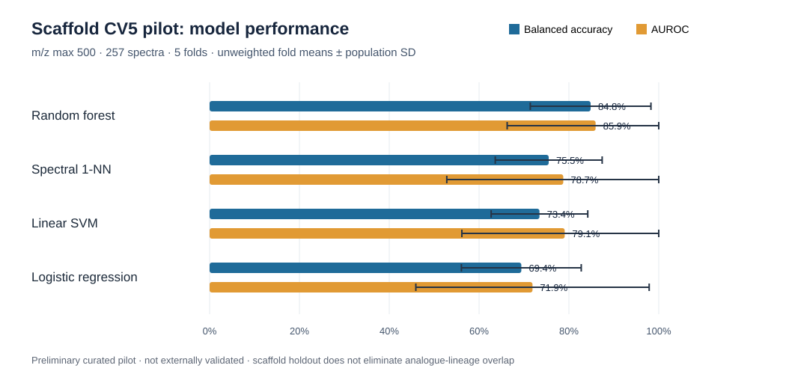
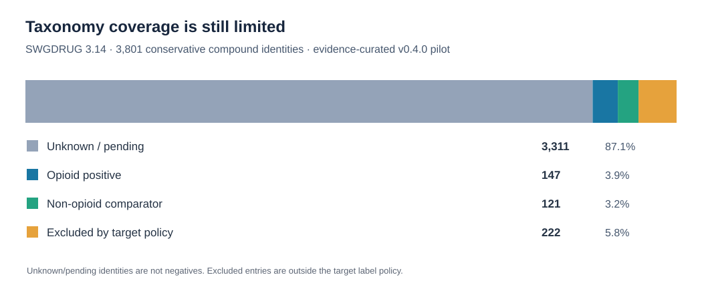

# Scaffold 5-fold pilot aggregate report (review only)

> **Status:** Preliminary evidence-curated pilot; **not externally validated** and **not approved for public scientific release**.
> This directory is staged on a review branch for human disclosure and provenance review.

## Scope

- Protocol: exact-scaffold-held-out five-fold cross-validation.
- Curated cohort: 257 spectra (139 opioid; 118 non-opioid).
- Four models: spectral 1-NN, logistic regression, linear SVM, random forest.
- Source artifacts reviewed locally: `summary.json`, `fold_metrics.csv`, and the scaffold split audit.
- Reported model metrics are **unweighted fold means and population standard deviations**. Pooled confusion counts sum held-out fold predictions and are not identical to mean fold metrics.
- Feature representation recorded in the supplied `summary.json`: nominal integer m/z bins, sqrt intensity, L2 normalization, **m/z maximum 500**. Do not combine this run with the frozen **m/z maximum 700** results elsewhere in the repository.
- The source `summary.json` describes these as pilot results that should not be generalized to the source inventory.

## Aggregate plots

The taxonomy plot is based on the repository's SWGDRUG 3.14 conservative compound-identity audit (3,801 identities), not on the 257-spectrum scaffold cohort.

## Aggregate results (five-fold mean)

| Model | Balanced accuracy | AUROC |
| --- | ---: | ---: |
| Random forest | 0.8483 | 0.8594 |
| Spectral 1-NN | 0.7550 | 0.7874 |
| Linear SVM | 0.7344 | 0.7906 |
| Logistic regression | 0.6940 | 0.7189 |

See `pilot_metrics.json` and `pilot_metrics.csv` for complete mean/std metrics and pooled confusion counts.

## Leakage-audit qualification

The uploaded scaffold split audit reported zero compound, exact-scaffold, and exact-spectrum train/test overlap for each fold, and zero near-identical cross-split pairs at its stated threshold. However, **opioid analogue-group overlap was nonzero in all five folds** (1, 5, 2, 4, 5 respectively). This is **scaffold-held-out**, not fully analogue-lineage-held-out validation.

## Required review before merge or public citation

1. Confirm source rights and whether these aggregates are approved for public release.
2. Reconcile the supplied **m/z max 500** experiment with the repository's frozen **m/z max 700** pilot; do not overwrite or silently conflate their performance.
3. Independently verify run provenance (dataset and taxonomy hashes, seed, environment, code commit, assignments checksum).
4. Review the fold audit, limitations, and high fold-to-fold variability before interpreting performance.
5. Obtain and validate corresponding other-protocol aggregates before producing a multi-protocol comparison.

**No raw spectra, assignments, predictions, or sample/compound identifiers are included in this directory.**
